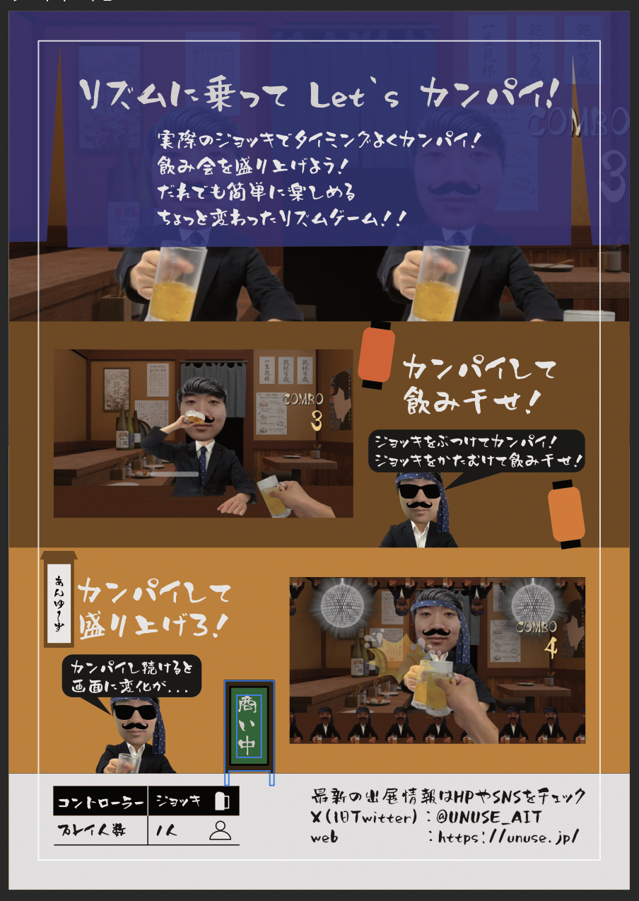

2026年10月31日（土）に開催される「東京ゲームダンジョン14」に『ビアリズム』を出展します！

『ビアリズム』は、乾杯とリズムゲームを組み合わせたゲームです。コントローラーは実物のジョッキ！ リズムに合わせてジョッキを振って、乾杯を成功させましょう。

## 出展情報

- 開催日：2026年10月31日（土）
- 会場：東京都立産業貿易センター 浜松町館
- ブース：**2G-11**
- 展示作品：『ビアリズム』

入場方法などの詳細は、[東京ゲームダンジョン公式サイト](https://tokyogamedungeon.com/)をご確認ください。

ブースでお待ちしています！
